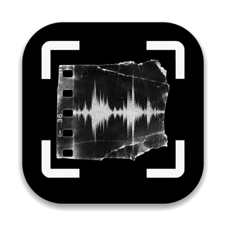
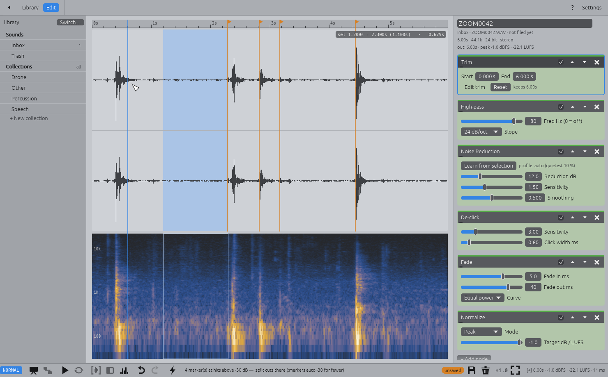
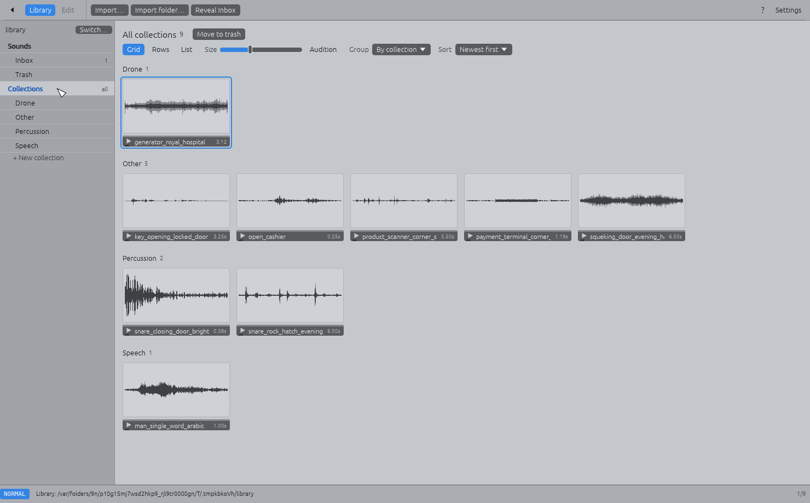
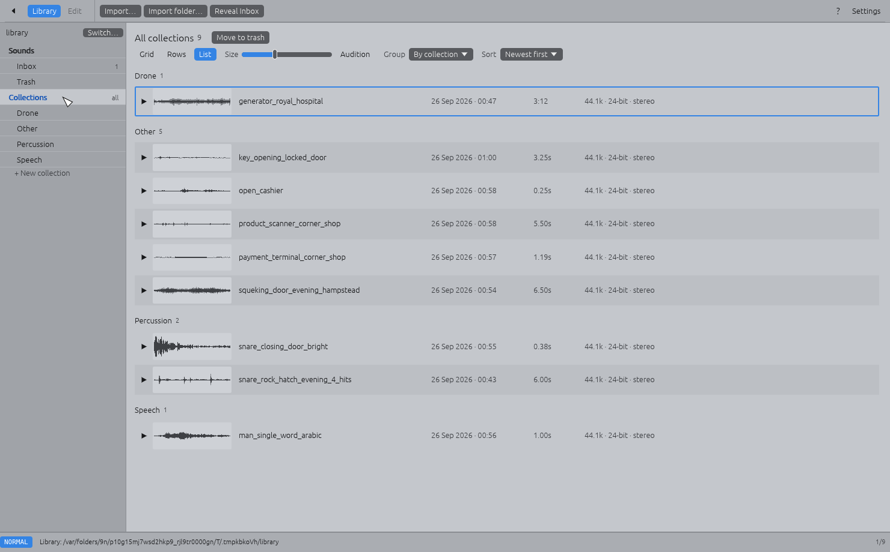
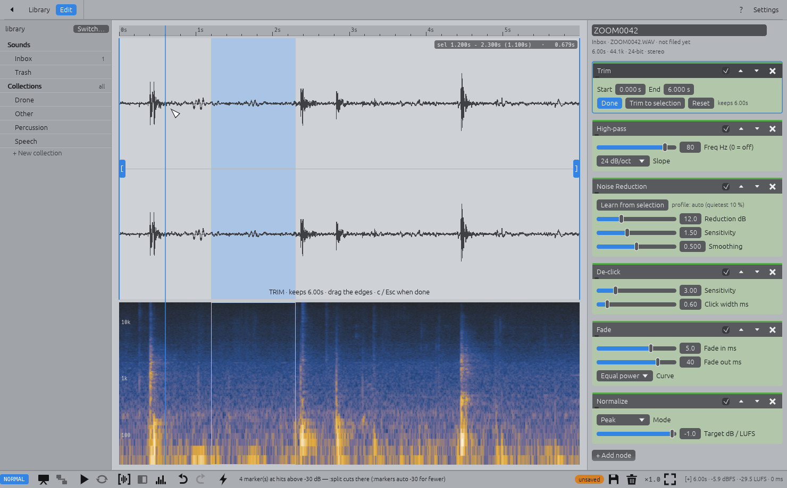
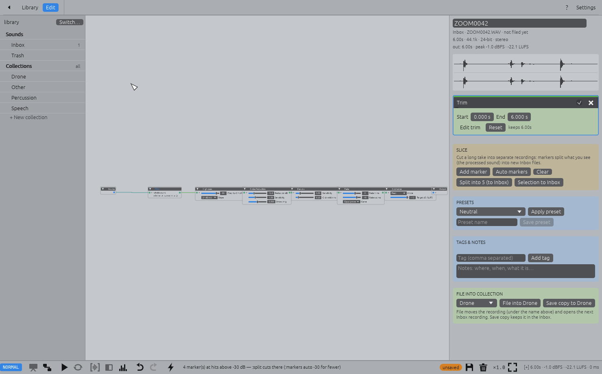
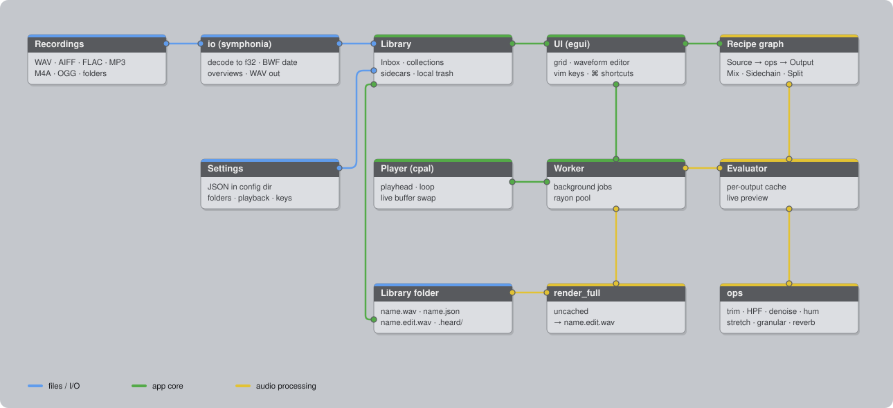

<p align="center"></p>

<h1 align="center">Heard</h1>

A desktop app for found sounds — doors, tills, generators, a word overheard in the street —
recorded on a field recorder or a phone. Trim, clean up, transform, tag, name and file them into
collections. The sound sibling of [Found](https://github.com/shmuga/found): Rust + egui, same
patcher look, everything stored as plain files.



## Typical workflow

1. **Bring sounds in:** drop recordings on the window (they land in the Inbox), point the Inbox
   at a recorder's card, or **Import folder…** a folder whose sub-folders become collections.
2. **Sort out** in the library: Space plays, `⌫` sends rejects to Trash, `cw` renames
   `ZOOM0042.WAV` to something you'll find again, double-click opens.
3. **Edit**: trim (`c`), high-pass, hum, noise reduction learned from a quiet selection — or a
   preset / **Apply last** (`A`). Experimental nodes (Paulstretch, freeze, granular, tape,
   resonator…) and **Patch** for branching recipes. Slice long takes with markers.
4. **File** into a collection (`m`, drag onto it, or *File into …*): the original keeps its
   name, the recipe is saved next to it and `name.edit.wav` rendered.

| Library | List | Trim | Patch |
|---|---|---|---|
|  |  |  |  |

## Architecture



Recordings are decoded with symphonia into the **Library** — plain folders plus JSON sidecars.
Each sound's edit is a **recipe graph** (egui-snarl; nodes can have several inputs and outputs);
the **Evaluator** runs it on a worker thread with a per-output cache for the live preview,
which the **Player** (cpal) swaps in while it plays. `render_full` re-runs it uncached to write
`name.edit.wav`. Originals are never modified. `python3 scripts/diagram.py` redraws the diagram.

## Run & build

```sh
cargo run --release                 # startup picker (or: cargo run --release -- <library>)
cargo test                          # DSP + library unit tests, headless UI tests
scripts/bundle-macos.sh --dmg       # → target/macos/Heard.app + Heard.dmg
```

GPL-3.0 · [credits](CREDITS.md)

# Reference

## Getting your sounds in

- **New library:** pick an empty folder on the startup picker.
- **Import folder…** (toolbar, ⇧⌘I, `:importfolder`, or drop a folder on the window) copies a
  folder in. Each sub-folder becomes a collection (`Drone/`, `Percussion/`, …) and its sounds
  are filed as they are: names kept, nothing rendered, re-editable later. Files lying loose in
  the folder go to the Inbox. The source folder isn't touched.
- **Import…** (⌘I) or dropping files copies recordings into the **Inbox**. You can also point
  the Inbox at a recorder's card or a Voice Memos export folder (Settings › Library folders).

Formats: WAV / BWF (16/24/32-bit, float), AIFF, FLAC, MP3, M4A (AAC and ALAC, i.e. iPhone
Voice Memos), Ogg Vorbis, CAF. BWF recording dates from field recorders are shown in the
editor.

## Names

Recorders name files `ZOOM0042.WAV` or `New Recording 12.m4a`, so renaming is quick:

- Editor: the name field at the top of the side panel. Press Enter to rename.
- Library: `cw` (or right-click › Rename…, `:name …`). With several sounds selected you get
  `name-01`, `name-02` …
- Filing keeps the name. A clash gets `-2`.

The original, its rendered edit and its recipe always share a name:

```
library/
  Inbox/                              recordings to process
  .heard/inbox-edits/                 in-progress recipes for Inbox recordings
  .heard/trash/                       local trash (restorable)
  Drone/
    generator_royal_hospital.wav      original, never modified
    generator_royal_hospital.edit.wav rendered edit
    generator_royal_hospital.json     recipe, tags, notes
  _presets/                           your presets
```

Rendered edits are WAV at the source's sample rate and channel count (unless a Channels node
changes it), 24-bit, or 32-bit float when the source is float. A sound filed without any
edits has no `.edit.wav`; the original is the sound.

## Editing

Double-click a sound (or Enter) to open it. The **waveform** shows the processed result:

- **Space** plays or stops it (the selection, if there is one; Loop in the bottom bar). Drag
  to select, click to set the playhead, pinch or ⌘-scroll to zoom, scroll to pan.
- **Before** (`\`) shows and plays the original.
- **Spectrogram** (`s`) runs underneath on a log-frequency scale. Hum shows up as bright
  horizontal lines, hiss as a haze at the top.
- **Trim** (`c`) shows the whole recording: drag the `[` `]` handles, or `s` / `e` to set the
  start / end at the playhead, or `h l [ ]` to nudge.
- **Slice:** `,` drops a marker at the playhead (or **Auto markers** / `:markers auto -30`
  for one marker per hit), then **Split** (`:split`) cuts what you see into new Inbox
  recordings (`name-01.wav` …). **Selection to Inbox** (`:extract`) keeps one part.

The recipe is a node chain (presentation view: slider cards; **Patch** / Tab: node graph with
branches and a two-input **Mix**). Nothing is written until you save (⌘S / `:w`): Inbox
sounds save the recipe, filed sounds re-render their edit.

### Clean up

| Node | What for |
|---|---|
| Trim / Auto Trim | Cut the start and end; strip silence around a hit |
| High-pass | Rumble, wind, handling noise, 80–120 Hz |
| Low-pass | Hiss, harshness |
| Hum Removal | Mains hum at 50 / 60 Hz plus harmonics (narrow notches) |
| Noise Reduction | Spectral gating. **Learn from selection**: select a stretch of just noise, click Learn (`:learn`); otherwise it learns from the quietest 10 % |
| De-click | Clicks, pops, crackle (redrawn by interpolation) |
| EQ | Low shelf, mid bell, high shelf |
| Gate / Compressor | Silence the gaps, even out the level |
| Fade, Gain | |
| Normalize | Peak (dBFS) or loudness (LUFS, ITU BS.1770), so a library sits at a consistent level |
| Channels | Mono mix, pick a side, swap, stereo width |
| Loop | Crossfade the end into the start for seamless drones / room tones |

### Experimental

Reverse · Varispeed (tape speed) · **Paulstretch** (×1–50 smeared texture) · **Freeze**
(hold one moment of the spectrum) · Pitch Shift · **Granular** · Stutter · Bit Crush ·
**Tape** (wow, flutter, saturation, hiss) · Ring Mod · **Resonator** (makes noise ring at a
pitch) · Echo · Reverb · Drive · Mix (2 inputs) · Sidechain (2 inputs) · Split (3 outputs). 🎲 randomizes a node, **Mutate** (`M`)
re-rolls every experimental node. Everything is seeded, so a recipe always renders the same.

**Multiple inputs / outputs** (Patch view): any output can feed as many inputs as you like
(branches are computed once). **Mix** layers B over A, plays them in sequence or multiplies
them. **Sidechain** makes A follow B's loudness: *gate* (A only where B sounds — a gated
reverb is two wires) or *duck*. **Split** has three outputs — low / mid / high bands that add
back up exactly — so you can treat each band differently and Mix them back.

### Presets

Clean up: Neutral, Field Clean, Voice, Percussion Hit, Drone Loop, Hum Kill, Hiss Kill.
Experimental: Paulstretch Cloud, Frozen Moment, Granular Rain, Reverse Swell, Tape Memory,
Metal Resonator, Lo-Fi Sampler, Octave Down, Stutter Edit, Shadow Double (a branching patch),
Crushed Highs (Split: bit-crush only the high band), Gated Reverb (Sidechain).
Applying a preset keeps the sound's trim and learned noise profile. **Apply last** (`A`, ⌘L)
reapplies the last preset or the last saved sound's recipe.

### How the cleanup chain was chosen

Field recordists usually work in stages. First a high-pass for rumble and wind (around
80–100 Hz). Then dedicated passes for steady noise: hum notches, and spectral de-noise that
learns its profile from a noise-only stretch, keeping the reduction moderate. De-click and
de-clip deal with impulsive damage. Throughout, they compare mild and strong settings before
committing, and loudness-normalise at the end. Heard's default order (Trim → High-pass →
Noise Reduction → Fade → Gain) and the Field Clean preset follow that. Noise Reduction is
spectral gating as in Audacity and *noisereduce*: per-bin mean and spread of the noise in dB,
a sensitivity of *n* standard deviations, and a smoothed mask to avoid "musical noise".
The experimental side draws on musique concrète practice: Schaeffer's *objet sonore*,
reversal, tape-speed changes, extreme time-stretching and granulation (Truax, Roads).

## Library

Grid / Rows / List (`:layout`). Rows makes each tile as wide as the sound is long, on a log
scale. Group by day, month or collection; sort by date or name. **▶** on a tile (or Space)
plays it. **Audition** plays sounds as the cursor moves. Drag sounds onto a collection to
move or file them, onto Trash to remove. Tags and notes (where, when, what) are searchable
with `/`.

## Keyboard

`?` (⌘/) shows everything for the current view. Vim-style modal keys are on by default
(`:set novim` turns them off).

- **Everywhere:** `:` command line with Tab completion · `u` / `Ctrl-r` · `q` back ·
  `gi gl ge gs gx` · `gt` / `gT` · `+ - = z1` (z1 zooms to the selection).
- **Library:** `hjkl` · `Space` play · `Enter` open · `v` / `s` select / mark · `/` search ·
  `cw` rename · `t` tag · `m` file · `dd` / `x` trash · `yy` / `p` copy a recipe onto the
  selection.
- **Editor:** `Space` play · `( ) { }` playhead · `0 $` · `,` marker · `c` trim · `s`
  spectrogram · `\` before/after · `j k h l H L` sliders · `w b` nodes · `B` bypass ·
  `o O` add node · `R M` randomize / mutate · `] [` next / previous sound · `Tab` patch ·
  `:w :q :wq :q!`.
- **Commands:** `:file Coll`, `:name …`, `:tag a b`, `:notes …`, `:preset Name`,
  `:savepreset Name`, `:trim 0.4 3.2`, `:trim sel`, `:markers auto -30|clear|1.5`, `:split`,
  `:extract`, `:learn`, `:saveas Coll`, `:import`, `:importfolder`,
  `:set loop|spectrogram|audition|novim`.
- **⌘:** ⌘S save · ⇧⌘S save copy · ⌘Z · ⌘K command line · ⌘F search · ⌘1 ⌘2 ⌘, views ·
  ⌘I / ⇧⌘I import · ⌘↩ file · ⌘[ ⌘] previous / next · ⌘Backspace trash.

## Settings

Stored in `~/Library/Application Support/heard/settings.json` (`HEARD_SETTINGS` overrides it):
recent libraries, open-last-on-startup, per-library Inbox / presets folders, audition, loop,
spectrogram, and the waveform cache folder.

## macOS app

```sh
scripts/bundle-macos.sh                 # → target/macos/Heard.app (this Mac's architecture)
scripts/bundle-macos.sh --dmg           # … plus target/macos/Heard.dmg
scripts/bundle-macos.sh --universal --dmg --notarize   # signed + notarized release build
```

Signing uses the first **Developer ID Application** certificate in your keychain (override
with `SIGN_IDENTITY`), with the hardened runtime; without one the app is ad-hoc signed and only
runs on this Mac. `BUNDLE_ID` overrides the identifier (`io.github.shmuga.heard`).

### Releases

Needs a *Developer ID Application* certificate (Xcode › Settings › Accounts › Manage
Certificates › +). Then:

```sh
scripts/bundle-macos.sh --universal --dmg          # build + sign app and DMG
xcrun notarytool submit target/macos/Heard.dmg --apple-id YOU --team-id TEAM --wait
xcrun stapler staple target/macos/Heard.dmg
gh release create v0.1.0 target/macos/Heard.dmg --title "Heard 0.1.0" --generate-notes
```

(`--notarize` does the two `xcrun` steps for you if you store a notarytool keychain profile
named `heard-notary`.)

Heard plays sound but never records, so it needs no microphone entitlement.

### Icon

The icon artwork is `assets/icon-source.png`, fitted into the macOS icon shape as
`assets/icon.png` (window, Dock and `Heard.app`). To change it:
`scripts/set-icon.sh path/to/square-picture.png` (or `a|b|c` for the generated designs in
`examples/icon.rs`), then `scripts/bundle-macos.sh`.

## Licence

[GPL-3.0](LICENSE). Credits, the DSP methods Heard implements and font licences:
[CREDITS.md](CREDITS.md).

## Tests

```sh
cargo test                                  # DSP + library unit tests, headless UI e2e (egui_kittest)
cargo test --test screens -- --ignored      # screenshots → target/screens/ (HEARD_SAMPLES=folder to use real sounds)
cargo test --release --test core -- --ignored real_sounds   # decode a real collection, read-only
cargo run --release --example bench -- take.wav             # per-node timings on a long take
```
